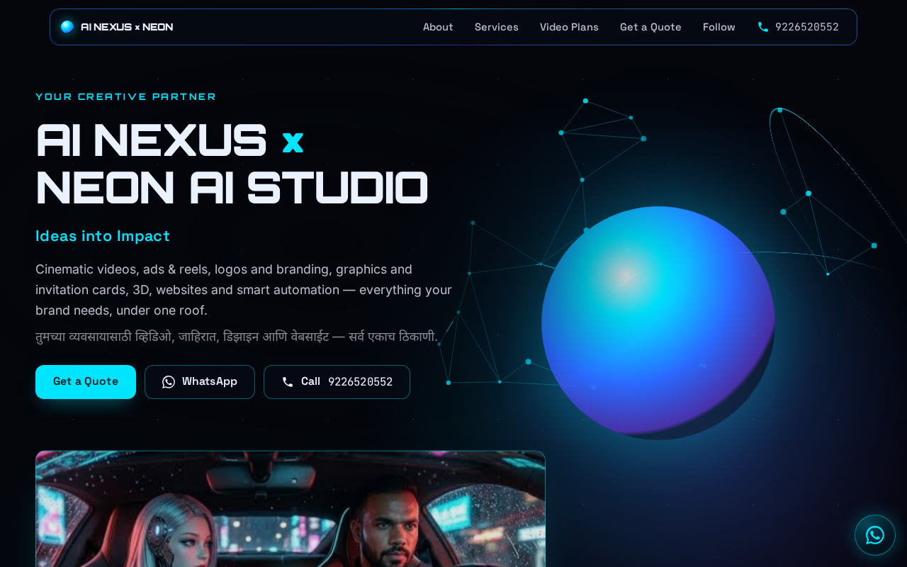
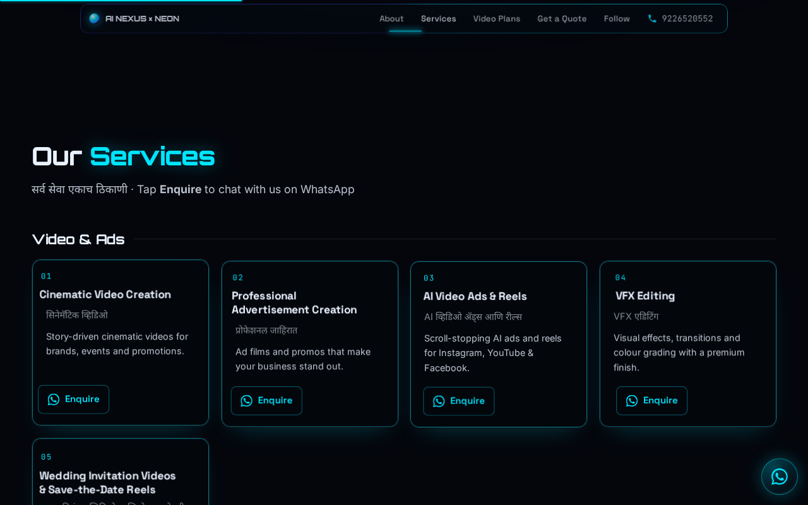
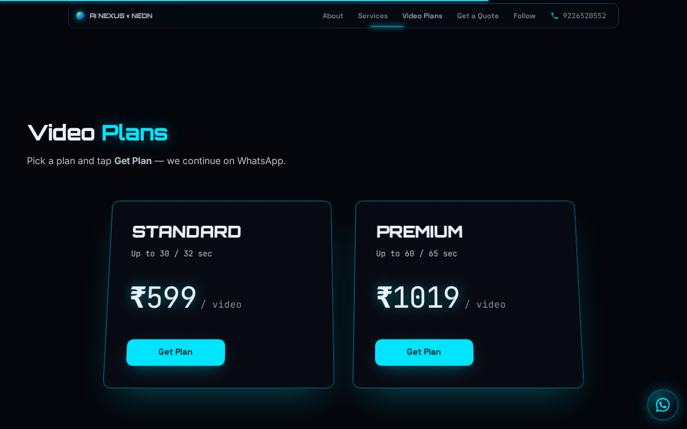
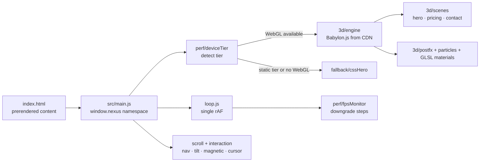

# AI Nexus × Neon AI Studio — Cinematic 3D Website

> Marketing site for **AI Nexus × Neon AI Studio** (an AI video, ads, graphics & web studio), built with **Babylon.js / WebGL**, custom **GLSL** shaders, scroll-driven storytelling and an adaptive performance system — no build step required.

[](https://neonaistudio.in)


**Live demo:** <https://neonaistudio.in>

## Screenshots

| Hero | Services |
| --- | --- |
|  |  |

| Video plans |
| --- |
|  |

_Captured at 1280×800 from the live site. In headless/software-rendered browsers the site automatically shows its CSS-only hero instead of the WebGL scene (see "Performance tiers")._

## Features

- **3D / WebGL scenes with Babylon.js** — hero core, pricing panels and a contact "command centre" scene, sharing one engine and one central render loop.
- **Custom GLSL shaders** — holographic, energy-pulse, neural-filament and particle shaders (sources in `src/3d/shaders/`).
- **Post-processing** — HDR pipeline with ACES tone mapping, bloom, vignette, and (high tier only) depth of field, chromatic aberration and glow layer.
- **Scroll-driven journey** — custom scroll driver and section observer (no GSAP).
- **Adaptive performance** — device-tier detection (viewport, CPU cores, device memory, `prefers-reduced-motion`, `prefers-reduced-data`, Save-Data) plus an FPS governor that steps quality down when the frame rate drops.
- **Graceful fallback** — a CSS-only hero (`src/fallback/cssHero.js`) when WebGL or Babylon.js is unavailable, and a static pre-rendered hero on small screens.
- **Content & SEO** — pre-rendered services and plans, JSON-LD structured data, Open Graph image, self-hosted fonts, accessible markup (skip link, ARIA landmarks).
- **Bilingual copy** — English with Marathi subtitles on the services.
- **Lead capture via WhatsApp** — each service/plan "Enquire" button opens a `wa.me` link with a pre-filled message (`src/config.js`, `src/pricing/plans.js`).
- **Google sign-in page** — `login.html` uses Firebase Authentication (Google provider).

## Tech stack

| Area | Tools |
| --- | --- |
| Language | JavaScript (ES modules), HTML5, CSS3 |
| 3D / graphics | Babylon.js 7.54.3 (loaded from the official CDN after page load), GLSL |
| Auth | Firebase Authentication (compat SDK 10.12.2) for the login page |
| Hosting | GitHub Pages with a custom domain (`CNAME`) |

## How it works



Every module in `src/` exports `init()` and `dispose()`. Babylon.js is loaded asynchronously after the page has loaded so that it does not block the first paint.

### Performance tiers

| Viewport | Tier |
| --- | --- |
| ≥ 1280 px | full (bloom, depth of field, chromatic aberration, glow) |
| 768–1279 px | reduced |
| 480–767 px | simplified, hero-focused |
| ≤ 479 px, reduced-data or Save-Data | static pre-rendered hero (no WebGL) |

Software renderers (e.g. SwiftShader) are detected and downgraded to the CSS hero.

### URL switches (for testing)

- `?tier=static|simple|mid|high` — force a device tier
- `?gl=0` — skip WebGL (CSS hero)
- `?gl=force` or `?governor=off` — render WebGL even on a software renderer / disable the FPS governor

## Project structure

```
index.html                 prerendered page (copy, services, plans, SEO, JSON-LD)
src/main.js                entry point, single window.nexus namespace
src/config.js              WhatsApp number, showreel id, Babylon.js CDN URL
src/loop.js                central requestAnimationFrame loop
src/3d/                    engine, materials, post-FX, particles, dispose registry
src/3d/scenes/             hero, pricing, contact, shared layout
src/3d/shaders/            GLSL sources (+ inlined .glsl.js modules)
src/scroll/                scroll journey + section observer
src/interaction/           nav, tilt, magnetic, hover, cursor
src/pricing/               plan data and "Get Plan" state handling
src/perf/                  device tier + FPS monitor
src/fallback/cssHero.js    CSS-only hero
src/styles/                design tokens, typography, layout, components
assets/                    self-hosted fonts, pre-rendered hero stills
login.html                 Firebase Google sign-in
```

## Getting started

No build step is needed.

```bash
git clone https://github.com/ppro916/neonaistudio.gitHub.io.git
cd neonaistudio.gitHub.io
python3 -m http.server 8000
# open http://localhost:8000
```

An ES-module site must be served over HTTP (opening `index.html` via `file://` will not load modules).

## Configuration

This is a static site, so there are no server-side environment variables. Edit `src/config.js` for site constants:

| Constant | Purpose |
| --- | --- |
| `WA_NUMBER` | WhatsApp number used by the `wa.me` enquiry links |
| `YOUTUBE_URL` | YouTube channel URL (currently empty; the card falls back to the showreel video) |
| `SHOWREEL_ID` | YouTube video id used for the showreel |
| `BABYLON_URL` | Babylon.js CDN URL |

> **Firebase note:** the Firebase *web* config in `firebase.js` / `login.html` is public by design. Access is controlled by Firebase Authentication settings and Firestore/Storage security rules in the Firebase console, so keep those rules restrictive.

## Roadmap

- [ ] Add the official YouTube channel URL in `src/config.js`
- [ ] Add automated Lighthouse / accessibility checks in CI
- [ ] Add a portfolio gallery of finished client work

## License

Source code is released under the [MIT License](LICENSE). Brand assets (logos, posters, hero images) belong to AI Nexus × Neon AI Studio and are not covered by the MIT grant.

## Author

**Moreshwar Bhonde** — AI & Data Science engineering student, AI-first developer, founder of AI Nexus × Neon AI Studio.

- GitHub: [@ppro916](https://github.com/ppro916)
- Website: [neonaistudio.in](https://neonaistudio.in)
